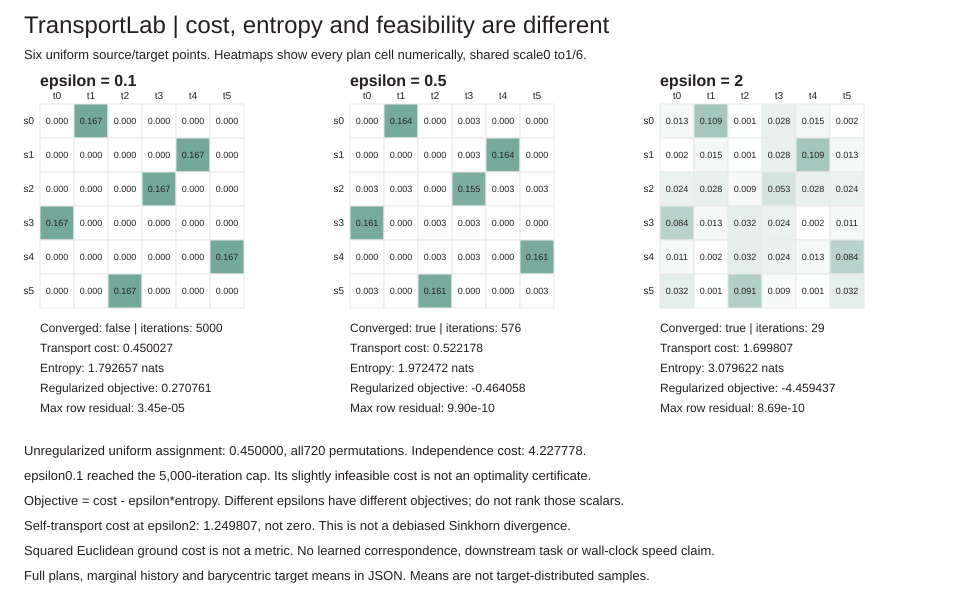

# TransportLab

**Inspect the plan, not just a distance-shaped number.** Dependency-free log-domain entropic optimal transport with full mass plans, explicit marginal convergence, zero-weight support, exact tiny uniform-assignment references and barycentric target means.



## Run offline

```sh
python -m unittest discover -s tests -v
python -m transportlab demo > /tmp/transport-demo.json
python examples/render_demo.py /tmp/transport-demo.json --check
python -m transportlab solve examples/points.json --epsilon .5
python -m transportlab assignment examples/points.json
```

Python3.10+, standard library only. No downloaded model, dataset, account, GPU or paid API. JSON input has exactly `source_points`, `target_points`, `source_weights`, `target_weights`. CLI `solve` returns a result even when the iteration budget is exhausted: **check `converged` and both residuals**. An unconverged result is not silently repaired or labeled optimal. `assignment` is limited to equal-size uniform weights, not general marginals.

## Mathematical contract

For nonnegative cost C and probability marginals a,b, the objective is

```
min_P sum(P_ij*C_ij) + epsilon * sum(P_ij*log(P_ij))
subject to P >= 0, P*1 = a, transpose(P)*1 = b
K_ij = exp(-C_ij/epsilon)
P_ij = exp(log_u_i - C_ij/epsilon + log_v_j)
log_u_i = log(a_i) - logsumexp_j(-C_ij/epsilon + log_v_j)
log_v_j = log(b_j) - logsumexp_i(-C_ij/epsilon + log_u_i)
```

Entropy is `-sum(P*log(P))` in nats, so `regularized_objective = transport_cost - epsilon*entropy`. This convention omits the optional `-epsilon*sum(P)` constant. Transport cost, entropy and regularized objective are separate outputs. Different epsilon values optimize different objectives, so their regularized scalars are not a shared ranking metric. Negative regularized objectives are expected, not negative transport costs.

Updates use log-sum-exp, not a pre-materialized kernel that can underflow entirely. Zero-weight rows/columns are removed during scaling and returned as exact zeros. A gauge recenter preserves `log_u+log_v`. Actual plan entries can still underflow to zero; their count is reported. The solver checks maximum absolute **row and column** marginal errors after each complete update, against tolerance1e-9 by default. Each full iteration ends with a target-column update, so small column error alone does not establish convergence.

Squared Euclidean ground costs are used by the point CLI and demo. They are not a metric. Finite-epsilon transport costs can have positive self-cost; this implementation is **not** the debiased Sinkhorn divergence, a Wasserstein metric, a differentiable training loss API or an exact general LP solver.

## Measured development fixture

Six fixed synthetic2D points; targets are a permuted translation(+0.6,-0.3). Uniform marginals. No learned embeddings, hidden labels, architecture/seed search, hyperparameter selection or downstream matching claim. All three epsilon settings and the nonconverged arm remain visible.

| epsilon | Converged at1e-9 | Iterations | Transport cost | Entropy, nats | Regularized objective | Max row error |
| ---: | --- | ---: | ---: | ---: | ---: | ---: |
| 0.1 | no | 5000 cap | 0.450027 | 1.792657 | 0.270761 | 3.452e-5 |
| 0.5 | yes | 576 | 0.522178 | 1.972472 | -0.464058 | 9.903e-10 |
| 2 | yes | 29 | 1.699807 | 3.079622 | -4.459437 | 8.688e-10 |

All column residuals are below3e-16 on this run. The epsilon0.1 arm exhausted the original budget; it is not an exact feasible plan or a certified optimum, even though its cost is near the assignment reference. No epsilon was replaced to hide that failure. Converged means marginal tolerance met, not globally certified arithmetic accuracy or a reported duality gap.

Enumerating all720 assignments gives the unregularized equal-uniform OT reference0.45; the independent product coupling costs4.227778. The assignment minimum is valid in this narrow scope because equal uniform couplings are scaled doubly-stochastic matrices and a linear minimum occurs at a permutation vertex. The exhaustive routine is not offered for unequal weights or general rectangular OT. Reference enumeration is factorial, not scalable. The entropic and unregularized objectives differ.

Self-transport at epsilon2 costs1.249807 despite identical supports. A separate unequal-marginal, one-iteration counterexample has row error0.4 while columns are already accurate. Both run in the demo. The heatmaps display every plan cell with shared scale0..1/6 and numeric masses; no top-k or edge threshold hides mass. Full plans, history, input points and barycentric means are in JSON.

## Barycentric maps are not samples

`barycentric(plan, target_points)` computes each conditional target mean using that row's **actual** mass. Zero-mass rows return `None`. A diffuse plan can map points between target support points: those means do not reproduce the target empirical distribution and are not guaranteed one-to-one correspondences. On an unconverged plan, requested source masses may differ from actual row masses; the function does not conceal that distinction.

## Audits and bounds

16 tests check the closed-form symmetric2x2 solution, direct non-log scaling reference, zero-cost independence, zero weights, underflowed kernels, shared cost shifts and simultaneous cost/epsilon scaling, rectangular/permuted marginals, explicit nonconvergence, positive self-cost, exhaustive assignment/endpoints, barycentric means, no mutation, strict bounds and CLI rejection. CI runs Python3.10-3.13 plus the full fixture and reproduced SVG on3.11.

Probability sums must be within1e-12 of1, then are explicitly normalized by their supplied sums; original sums and normalized weights are returned.1-64 rows per side, finite nonnegative costs<=1e6, epsilon[1e-4,1e4], iterations1-5000, tolerance[1e-12,1e-3], active_cells*max_iterations<=10,000,000. Point coordinates[-100,100]; two coordinates only. Assignment size1-8. Booleans/nonfinite values fail. Bounds are resource limits, not convergence guarantees. Costs depend on coordinate units and must scale with epsilon to preserve a plan. [DESIGN.md](DESIGN.md) gives implementation details and limits.

## Source credit

Independent educational implementation based on **Marco Cuturi (2013), [Sinkhorn Distances: Lightspeed Computation of Optimal Transportation Distances](https://arxiv.org/pdf/1306.0895)**, especially the transport polytope/entropy definitions in Section2 and penalized objective, scaling form and alternating updates in Section4, Eq.2-3/Algorithm1. Here `epsilon=1/lambda`. The log-domain formulation is an algebraic rewrite for numerical stability; no copied code, MNIST result, speedup, constrained-alpha metric theorem or benchmark reproduction is claimed.

MIT license.
